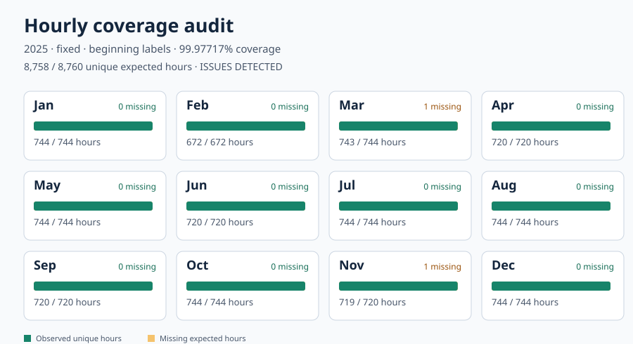

# Hourgrid Audit

**A read-only, zero-runtime-dependency audit for the hourly time axis behind solar, wind, storage, and other energy CSVs.**

An 8,760-row file is not necessarily an 8,760-hour dataset. A duplicated hour can conceal a missing hour; local daylight-saving timestamps can repeat or never exist; and an hour-ending convention can shift an entire series by one interval. Hourgrid Audit checks the declared timestamp contract **without modifying source data, guessing a timezone, or imputing values**.



*Illustrative output, not real production data: 8,759 rows contain 8,758 unique hours, two missing hours and one duplicate.*

## Why this exists

Energy workflows regularly mix several legitimate time conventions. For example, pvlib's NSRDB interface distinguishes UTC from **local standard time**, and its TMY3 example explicitly shifts hour-ending timestamps for solar-position calculations. Python's IANA timezone support distinguishes repeated local times with a `fold` flag. These are not interchangeable conventions. This tool supplies a small, explicit **quality gate before** downstream modeling or optimization.

This is **not** a weather-file parser, ETL pipeline, forecast validator, data repairer, or a replacement for pvlib/pandas. Libraries such as [pvlib](https://github.com/pvlib/pvlib-python) and [diive](https://github.com/holukas/diive) already support richer ingestion and time-series quality workflows. Hourgrid Audit is differentiated by a narrowly defined, dependency-free CLI that checks an *externally declared* hourly contract and produces reproducible JSON plus a single-file visual diagnostic. No claim of unique functionality or comprehensive prior-art coverage is made.

## Quick start

Python **3.10+**. Runtime uses only the standard library. On Windows, IANA civil-time mode may require a system timezone database or the optional `tzdata` package; fixed/aware modes do not.

```bash
python -m pip install -e .
python examples/make_example.py
hourgrid-audit examples/synthetic_2025.csv \
  --year 2025 --basis fixed --offset-hours -7 \
  --value-column power_kw \
  --report examples/example-report.json \
  --svg examples/example-coverage.svg
```

The sample **intentionally fails** the quality gate: the CLI returns exit code `1`, reporting `2` missing hours and `1` duplicate. A passing complete dataset returns `0`; an invalid input schema or configuration returns `2`. Use this exit-code contract in CI, for example:

```bash
hourgrid-audit path/to/production.csv --year 2025 --basis aware --value-column power_kw --report audit.json
```

No network requests, data mutation, or AI calls are performed.

## Declare the timebase—do not infer it

| `--basis` | Input timestamp format | Required options | Interpretation |
|---|---|---|---|
| `aware` | ISO8601 with explicit `Z` or `±HH:MM` | none | Normalize real instants to UTC; audit the **UTC calendar year**. |
| `fixed` | Naive ISO8601 (e.g. `2025-01-01T00:00:00`) | `--offset-hours -7` | Fixed UTC offset, **no daylight-saving adjustment**; audit the fixed-offset local calendar year. |
| `civil` | Naive ISO8601 local clock time | `--zone America/Denver` | Interpret IANA civil time with daylight-saving transitions; audit the local calendar year. |

For `civil`, ambiguous fall-back timestamps **must** include a `--fold-column fold` CSV field containing `0` (first occurrence) or `1` (second occurrence). A nonexistent spring-forward timestamp is rejected. The tool never chooses a fold based on row order. For unambiguous rows, `fold` may be empty or `0`.

By default timestamps mark the **beginning** of an hour. For files whose timestamps mark the **end** of the interval, add `--label ending`; the instant is shifted back one hour **after** timezone interpretation. The last hour of a 2025 hour-ending dataset is therefore labeled `2026-01-01T00:00:00` in its declared timebase. The year refers to the *hour-start calendar*, not necessarily the timestamp-label calendar.

`--timestamp-column` defaults to `timestamp`; `--value-column` is optional and checks numeric blanks/NaN/Infinity without imposing domain-specific nonnegativity assumptions. CSV column names must be unique.

## What the audit reports

- Expected and observed **unique UTC hour-start instants** for the declared calendar year (8,760 or 8,784 in ordinary fixed-offset/UTC years; civil-year duration is derived from the IANA zone).
- Missing and duplicated hourly slots; nonmonotonic order; invalid, off-grid, out-of-year and malformed timestamps; civil ambiguous/nonexistent times; optional missing or nonfinite numeric values.
- A deterministic SHA-256 of the original CSV, per-month expected/observed/missing counts, capped issue examples with original row numbers, machine-readable JSON and an accessible standalone SVG.

**Interpretation:** 100% hourly coverage means the expected time slots are represented once; it does **not** imply accurate sensors, correct values, unbiased samples, physically meaningful energy, or calibrated uncertainty. A complete series can still have missing or invalid values (reported separately when `--value-column` is used). The SVG's green/amber bar is a completeness diagnostic, not a confidence interval.

## Reproducible synthetic example

The generator creates 2025 hourly timestamps in **fixed UTC−07**, intentionally deleting `2025-03-09T02:00` and `2025-11-02T01:00`, and duplicating `2025-05-01T10:00`. The chosen dates coincide with U.S. DST transitions, but fixed local standard time does **not** observe DST; both deleted hours are genuine missing slots under this contract.

Observed output:

```json
{
  "rows": 8759,
  "expected_hours": 8760,
  "observed_unique_hours": 8758,
  "coverage_percent": 99.97717,
  "issue_counts": {"duplicate_hour": 1, "missing_hour": 2},
  "ok": false
}
```

The full deterministic output is in [`examples/example-report.json`](examples/example-report.json); the visualization is in [`examples/example-coverage.svg`](examples/example-coverage.svg). The generated 8,759-row CSV is **not committed**; regenerate it locally to verify its SHA-256 and the report.

## Tests and observed performance

```bash
PYTHONPATH=src python -m unittest discover -s tests -v
```

**Observed on 2026-10-13:** 15 unit tests passed, covering fixed-offset and offset-aware years, 8,784-hour leap years, hour-ending rollover, both civil DST transitions and explicit folds, a half-hour-offset IANA zone, malformed data, off-grid instants, numeric values, and CLI exit codes. A local 15-run benchmark on the generated 8,759-row example measured **median 0.038 s** per audit (minimum 0.036 s, maximum 0.042 s) in one ephemeral Python 3.13.5 container. To repeat the local timing test: `PYTHONPATH=src python scripts/benchmark.py examples/synthetic_2025.csv`. These are not comparative benchmarks, and results vary by hardware, disk, input shape and environment.

## Known limits and safeguards

- One **calendar year** per audit; only CSV with an ISO8601 timestamp column. No EPW/TMY3 parsing, subhourly samples, custom year boundaries, or automatic timezone detection.
- Civil zones with historical/non-hour DST offset transitions may not fit a uniform one-hour UTC grid; the audit rejects unsupported calendar durations or marks off-grid instants rather than silently coercing them.
- A year with UTC-aware timestamps is audited against a UTC year, even if the source timestamps display a non-UTC offset. To audit a local calendar year, use `fixed` or `civil` with naive local timestamps.
- The report does not verify a measurement's semantics, physical units, calibration, location or license; values are only checked for finite numeric parseability when requested.
- For very large CSVs, the audit keeps an expected-year set and a set of observed timestamps in memory; the source hash is streamed. No output is published or transmitted.

## Source context and provenance

This implementation was independently written from public API documentation and standard-library primitives; no employer, client or startup code/data were used. References are background context, **not** endorsements or benchmarks:

1. [Python `zoneinfo` and PEP 495 fold semantics](https://docs.python.org/3/library/zoneinfo.html).
2. [pvlib NSRDB TMY interface: UTC versus local standard time](https://pvlib-python.readthedocs.io/en/stable/reference/generated/pvlib.iotools.get_nsrdb_psm4_tmy.html).
3. [pvlib TMY3 example: end-of-hour labels and midpoint correction](https://github.com/pvlib/pvlib-python/blob/main/docs/examples/irradiance-decomposition/plot_diffuse_fraction.py).
4. [NREL SAM PV Model technical reference, §4.1](https://docs.nrel.gov/docs/fy18osti/67399.pdf).

## Status and license

**Private Build Lab review candidate**, not a publicly released repository. The owner must independently review the code, provenance, scope, and public release decision. MIT licensed; see [`LICENSE`](LICENSE). No package release, GitHub public-repository publication, LinkedIn post, or benchmark claim beyond the local measurements has been authorized.
